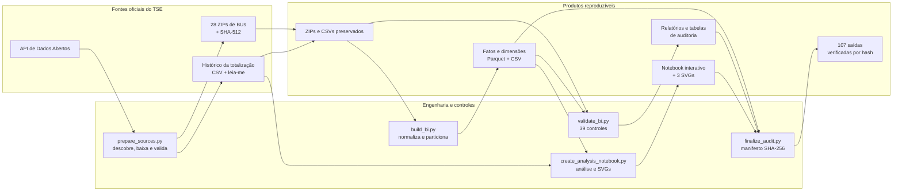
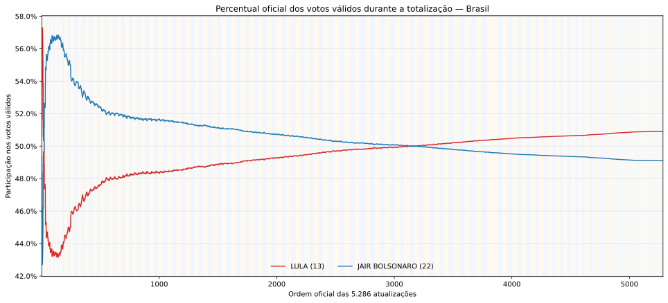
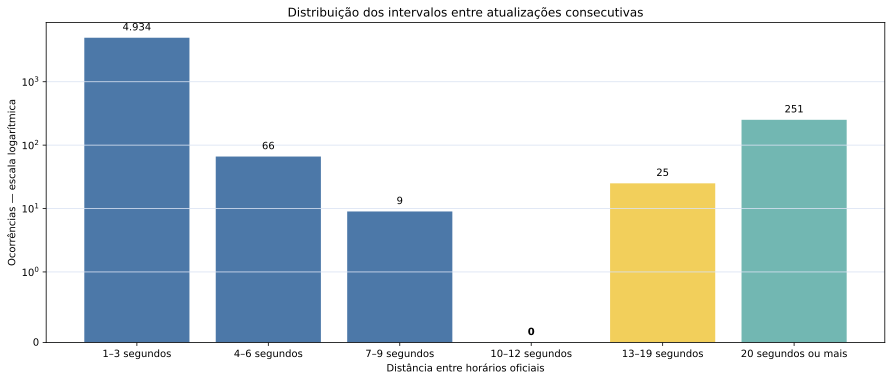
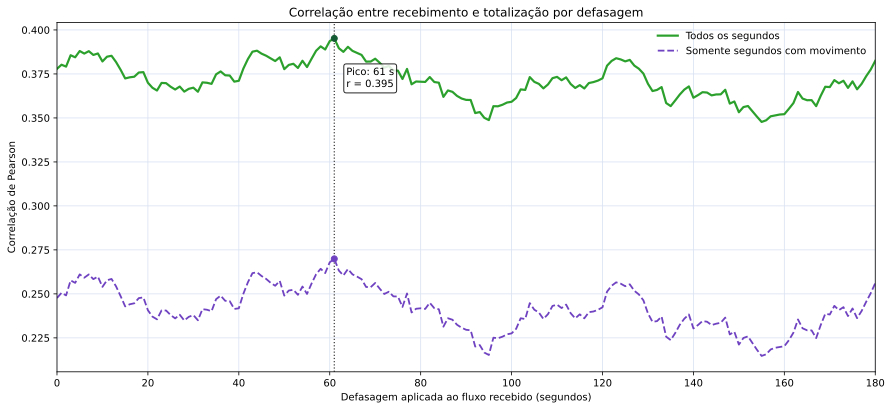

# Apurações eleitorais

Pipeline reproduzível de engenharia, validação e análise dos boletins de urna e do
histórico oficial da totalização presidencial do segundo turno de 2022.

O projeto baixa as fontes do Portal de Dados Abertos do TSE, valida sua integridade,
constrói uma camada analítica em Parquet, executa controles de qualidade e reproduz as
5.286 atualizações oficiais em um notebook interativo. Os dados brutos não são versionados:
eles são reconstruídos e conferidos pelo próprio pipeline.

## Objetivo

O objetivo é responder, de forma auditável, três perguntas:

1. os totais publicados no histórico da totalização conferem com a soma dos BUs divulgados?
2. como o recebimento dos BUs se relaciona temporalmente com as atualizações oficiais?
3. por que o percentual de um candidato sobe ou cai mesmo quando seus votos acumulados
   continuam aumentando?

O projeto não tenta recontar votos a partir de uma ordem inventada. A evolução percentual
vem do histórico oficial, preservando cada `DT_TOTALIZACAO`; os BUs são usados separadamente
para reconciliação e análise do fluxo de recebimento.

## O que é fonte, transformação e conclusão

| Camada | Responsabilidade | Exemplos |
| --- | --- | --- |
| **Dados oficiais** | Conteúdo publicado pelo TSE, preservado sem correção artificial | ZIPs e hashes SHA-512 dos BUs, CSV/PDF do histórico, `DT_BU_RECEBIDO`, `DT_TOTALIZACAO` e votos |
| **Engenharia do projeto** | Descoberta, download, validação, extração e modelagem reproduzível | scripts Python, fatos/dimensões Parquet, partições por UF e manifesto SHA-256 |
| **Auditoria** | Testes objetivos de integridade, reconciliação e qualidade | 39 controles, comparação por UF, alertas temporais e confronto dos totais finais |
| **Análise estatística** | Interpretação produzida pelo projeto, não uma afirmação oficial do TSE | correlações, defasagem de 61 segundos e delimitação de blocos observados |

Correlação não é probabilidade nem prova causal. Os blocos são rajadas delimitadas pelo
ritmo visível das atualizações; o histórico não publica um identificador interno de lote.
Esses limites estão detalhados na
[síntese da análise](2t2022/04_bi/auditoria/SINTESE_CORRELACAO_BU_TOTALIZACAO.md).

## Arquitetura do pipeline



O pipeline interrompe a execução diante de fonte incompleta, hash divergente, falha de
conversão, quebra de integridade referencial ou reconciliação incorreta. As saídas só são
publicadas depois que suas etapas terminam com sucesso.

**Tecnologias:** Python 3.12, DuckDB, Pandas, Parquet, SQL, Jupyter, Plotly, Matplotlib,
testes unitários, hashes SHA-256/SHA-512 e integração preparada para Power BI.

## Resultados verificados

- 28 conjuntos de BUs — 27 UFs e exterior — descobertos e validados;
- 5.286 atualizações oficiais preservadas na ordem de `DT_TOTALIZACAO`;
- 472.028 BUs de Presidente representados no BWeb;
- totais finais de Lula, Bolsonaro, brancos e nulos reconciliados sem diferença;
- [39 controles de auditoria](2t2022/04_bi/auditoria/resultado_validacao.csv):
  **0 falhas e 3 alertas da fonte preservados**;
- [5 testes automatizados](tests/test_pipeline_edge_cases.py) para casos de borda do
  download e da extração;
- notebook com 26 células executadas sem erro;
- [107 saídas](2t2022/04_bi/auditoria/manifesto_saidas.csv) registradas e verificadas
  por tamanho e SHA-256;
- três gráficos SVG determinísticos: execuções repetidas produzem os mesmos hashes.

Os alertas correspondem a 600 recebimentos anteriores à emissão, uma emissão anterior ao
encerramento e um BU sem horário de emissão. Eles permanecem registrados, sem alteração dos
dados, no [relatório de validação](2t2022/04_bi/auditoria/RELATORIO_VALIDACAO.md).

## Estrutura e produtos

| Caminho | O que contém ou produz | Versionamento |
| --- | --- | --- |
| `2t2022/01_origem_zip/` | ZIPs e hashes oficiais baixados | reconstruído; fora do Git |
| `2t2022/02_dados_csv/` | CSVs extraídos sem transformação | reconstruído; fora do Git |
| `2t2022/03_documentacao/` | leia-me oficial do formato BWeb | versionado |
| `2t2022/04_bi/fontes/` | histórico oficial da totalização e documentação | conteúdo reproduzível; hashes fixados |
| `2t2022/04_bi/dados/` | fatos, dimensões e agregações para BI | reconstruído; fora do Git |
| `2t2022/04_bi/auditoria/` | controles, alertas, reconciliações e manifestos | versionado |
| `2t2022/04_bi/notebooks/` | análise executada com gráficos interativos | versionado |
| `2t2022/04_bi/graficos/` | três SVGs vetoriais usados nos READMEs | versionado |
| `2t2022/04_bi/scripts/` | preparação, modelagem, validação e análise | versionado |
| `tests/` | regressões dos casos de borda encontrados na revisão | versionado |
| `1t2026/` e `2t2026/` | pré-projetos de download para publicações futuras | versionado; sem análise antecipada |

O [inventário completo](2t2022/INVENTARIO.md) documenta arquivos, quantidades e fontes.
A camada analítica possui ainda um [guia para Power BI](2t2022/04_bi/GUIA_POWER_BI.md).

## Reproduzir o segundo turno de 2022

Pré-requisitos: Python 3.12 ou compatível, suporte a `venv`, internet e espaço em disco
para os arquivos brutos e Parquets.

```bash
cd 2t2022
./04_bi/executar_pipeline.sh
```

O comando:

1. consulta a API do TSE e descobre os recursos oficiais;
2. baixa os arquivos com retomada e valida SHA-512, CRC e SHA-256;
3. extrai os CSVs preservando as fontes originais;
4. constrói fatos e dimensões Parquet para BI;
5. executa os controles e gera o relatório de auditoria;
6. recria o notebook e exporta os gráficos SVG;
7. gera e verifica o manifesto criptográfico das saídas.

O ambiente virtual e as dependências são criados pelo próprio comando. Para verificar as
saídas existentes sem reconstruir a camada:

```bash
cd 2t2022
.venv/bin/python 04_bi/scripts/finalize_audit.py --verificar
```

## Gráficos principais

Os gráficos são SVGs vetoriais gerados pelo pipeline, não capturas de tela. Clique em
qualquer um para abrir o notebook com zoom, seleção pela legenda e informações no hover.

### Evolução percentual e blocos observados

[](2t2022/04_bi/notebooks/analise_evolucao_votos.ipynb)

### Distribuição dos intervalos entre atualizações

[](2t2022/04_bi/notebooks/analise_evolucao_votos.ipynb)

### Correlação por defasagem

[](2t2022/04_bi/notebooks/analise_evolucao_votos.ipynb)

## Preparação das eleições de 2026

Os diretórios `1t2026/` e `2t2026/` são pré-projetos separados. Eles descobrem, baixam e
validam publicações oficiais quando disponíveis, mas não fabricam dados nem executam uma
análise eleitoral antecipada.

Primeiro turno:

```bash
cd 1t2026
./executar_preparacao.sh
```

Segundo turno:

```bash
cd 2t2026
./executar_download.sh
```
